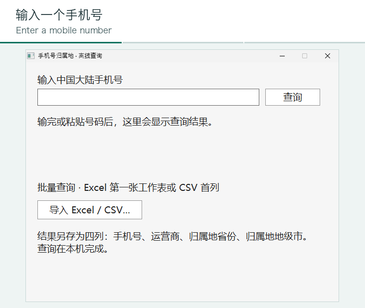

# PhoneRegion · Offline mobile number lookup for mainland China

[简体中文](README.md) · **English**

Find the **original carrier, province and prefecture-level city** for a mainland Chinese mobile number, or look up an entire spreadsheet on a Windows PC without an internet connection.

**[Download for Windows · PhoneRegion.exe](https://github.com/TaylorChyi/PhoneRegion/releases/latest/download/PhoneRegion.exe)**

Double-click the downloaded file to start. No installation, account or configuration is required. The app and its exported column headings are in Simplified Chinese. [All releases](https://github.com/TaylorChyi/PhoneRegion/releases)

## What you can do

- **Keep numbers on your PC.** The lookup data is included. Queries and exports work offline. Your numbers and files stay on your computer, and the app keeps no search history.
- **See a result as soon as you paste.** Enter `+86 132 1300 0000` to see China Unicom, Henan Province and Zhengzhou City immediately.
- **Look up a whole list at once.** Import an Excel workbook (`.xls` or `.xlsx`) or a CSV. Put the numbers in the first column and leave the other columns as they are. Excel does not need to be installed.
- **Use numbers as you receive them.** Mix `+86`, `0086` and `86` prefixes, full-width digits, spaces, brackets and hyphens. Several complete numbers separated by spaces in one cell become separate result rows.
- **Identify the city or its local equivalent.** Results use official names for prefecture-level cities, autonomous prefectures, prefectures, leagues and municipalities.
- **Identify the network and virtual operator.** Look up prefixes allocated to China Mobile, China Unicom, China Telecom and China Broadnet. Where the data includes a virtual operator, the result shows its brand alongside the underlying carrier.
- **Get a file you can check against the original.** Export to Excel or CSV. Valid numbers are normalised to 11 digits. The original order and duplicates are preserved, and the source file stays intact. The app reports counts for invalid inputs and missing prefixes.
- **Take it to another PC.** Copy the single `PhoneRegion.exe` file to a USB drive or another Windows 10 or 11 x64 PC and double-click it there. The interface follows your Windows light, dark or high-contrast settings.

## See it in action

## What a batch export looks like

Click **＋ 导入文件** (Import file) in the lower-left corner of the input box. Choose your spreadsheet, then choose where to save the results. PhoneRegion reads column A of the first worksheet or the first column of a CSV. A common heading such as 手机号 (mobile number) is optional.

| 手机号 · Mobile number | 运营商 · Carrier | 归属地省份 · Province | 归属地地级市 · City |
| --- | --- | --- | --- |
| 13213000000 | 中国联通 | 河南省 | 郑州市 |
| 13900200000 | 中国移动 | 广东省 | 广州市 |
| 18901600000 | 中国电信 | 上海市 | 上海市 |

## Understanding the result

The included dataset is dated **22 October 2026**. Of its **522,410** seven-digit prefixes, **517,515** have a known prefecture-level area. For the remaining **4,895**, the province is shown and the city is left blank. Invalid inputs and unlisted prefixes stay in the export with the three lookup fields blank.

Carrier and area describe the original allocation of the number prefix. The current carrier may differ after a number has been ported. A prefix cannot tell you where a person or phone is now. [Data source](data/SOURCE.md)

**Keywords**　mainland China mobile numbers · original carrier · prefecture-level city · offline phone number lookup · Excel and CSV batch lookup
