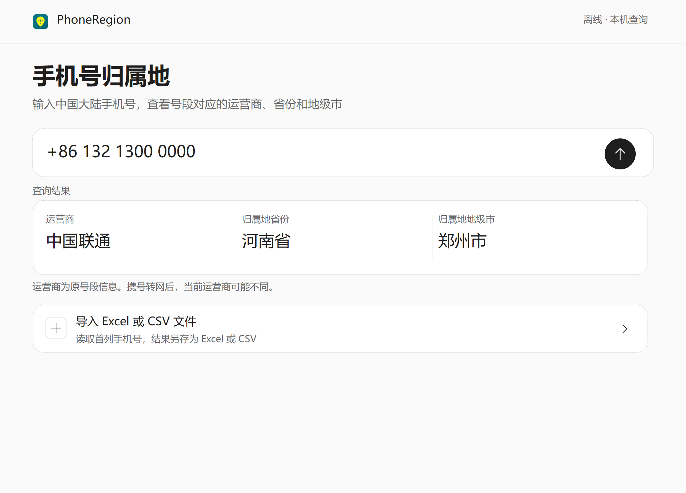

<p align="center"></p>

<h1 align="center">PhoneRegion</h1>

<p align="center"><strong>Offline mobile number lookup for mainland China</strong></p>

<p align="center">PhoneRegion provides offline phone number lookup through a Windows desktop app and a JSON CLI for scripts and AI agents. Enter a mainland Chinese mobile number for a carrier lookup by its seven-digit prefix, or enrich an Excel or CSV list with the original carrier, province and prefecture-level area for each number.</p>

<p align="center"><a href="README.md">简体中文</a> · <strong>English</strong> · <a href="#agent-reference">Agent reference</a></p>

<p align="center">
  <a href="https://github.com/TaylorChyi/PhoneRegion/releases/latest"></a>
  
  
  
</p>

<p align="center">
  <strong>Original network operators</strong><br>
  
  
  
  
</p>

<p align="center">
  <a href="https://github.com/TaylorChyi/PhoneRegion/releases/latest/download/PhoneRegion.exe"></a>
  <a href="https://raw.githubusercontent.com/TaylorChyi/PhoneRegion/main/download/phone-region-cli.exe"></a>
</p>

<p align="center">Double-click the GUI to run it. Numbers and files stay on your PC during lookup and export. The app keeps no search history. The interface and export headings are in Simplified Chinese. <a href="https://github.com/TaylorChyi/PhoneRegion/releases">All releases</a></p>

<p align="center">
  <picture>
    <source media="(prefers-color-scheme: dark)" srcset="docs/window-dark.png">
    
  </picture>
</p>

<p align="center">The app follows your Windows light, dark or high-contrast settings.<br><a href="docs/window-light.png">Full-size light view</a> · <a href="docs/window-dark.png">Full-size dark view</a></p>

<h2 align="center">Look up one number</h2>

<p align="center">Paste <code>+86 132 1300 0000</code> to see <strong>China Unicom · Henan Province · Zhengzhou City</strong>.<br>You can use <code>+86</code>, <code>0086</code> or <code>86</code> prefixes, full-width digits, spaces, brackets and hyphens within the number.</p>

<h2 align="center">Look up and export a list</h2>

<p align="center">
  
  
</p>

<p align="center"><a href="https://github.com/TaylorChyi/PhoneRegion/releases/download/v1.3.2/example.csv"><strong>Download a sample CSV</strong></a>, or click <strong>保存示例 CSV (Save sample CSV)</strong> above the drop area to get the same file offline.</p>

<p align="center">Drop the file onto <strong>点击或拖入文件 (Click or drop a file)</strong>, or click the box to browse. The app reads column A of the first worksheet or the first CSV column. A heading such as 手机号 (mobile number) is optional. Excel does not need to be installed.<br>Separate complete numbers in the same cell with spaces to look up each one.</p>

<p align="center">After lookup, click <strong>导出结果 (Export results)</strong> below the drop area and choose a format and location. Valid numbers are normalised to 11 digits, with order and duplicates preserved. You can export again. The original file stays intact.</p>

<table align="center">
  <thead><tr><th align="center">手机号<br><sub>Mobile number</sub></th><th align="center">运营商<br><sub>Carrier</sub></th><th align="center">归属地省份<br><sub>Province</sub></th><th align="center">归属地地级市<br><sub>Prefecture-level area</sub></th></tr></thead>
  <tbody>
    <tr><td align="center">13213000000</td><td align="center">中国联通</td><td align="center">河南省</td><td align="center">郑州市</td></tr>
    <tr><td align="center">13900200000</td><td align="center">中国移动</td><td align="center">广东省</td><td align="center">广州市</td></tr>
    <tr><td align="center">18901600000</td><td align="center">中国电信</td><td align="center">上海市</td><td align="center">上海市</td></tr>
  </tbody>
</table>

<h2 align="center">See it in action</h2>

<p align="center"></p>

<h2 align="center">Data coverage and interpretation</h2>

<p align="center">
  <a href="data/SOURCE.md"></a>
  
  
  
</p>

<p align="center">The carrier, province and prefecture reflect the original prefix allocation. The current carrier may differ after number porting. A prefix cannot identify a phone’s current location. Where available, the virtual operator’s brand appears alongside the underlying carrier.</p>

<p align="center">The area field uses the official name of the city, autonomous prefecture, prefecture, league or municipality. It stays blank when only the province is known. Invalid numbers and unlisted prefixes remain in the export with all three lookup fields blank. <a href="data/SOURCE.md">Data source</a></p>

<a name="agent-reference"></a>

<h2 align="center">CLI for scripts and AI agents</h2>

Open PowerShell in the download folder and run `.\phone-region-cli.exe describe` for machine-readable commands, result fields and exit codes. For Windows x64, [download the CLI executable](https://raw.githubusercontent.com/TaylorChyi/PhoneRegion/main/download/phone-region-cli.exe). With Rust installed, run `cargo build --locked --release --bin phone-region-cli` from the repository root to build a native binary in `target/release/`.

| Operation | PowerShell example |
| --- | --- |
| Look up one or more numbers, each as a separate argument | `.\phone-region-cli.exe lookup "+86 132 1300 0000" "13900200000"` |
| Read a JSON array of strings from standard input | `'["13213000000",""]' \| .\phone-region-cli.exe lookup --stdin` |
| Read an Excel or CSV file and save a new export | `.\phone-region-cli.exe batch .\example.csv .\results.xlsx` |
| Show usage or version | `.\phone-region-cli.exe --help` or `.\phone-region-cli.exe --version` |

**Calling from Python.** This example submits one valid number and one malformed number and reads the results in input order.

```python
import json
import subprocess

run = subprocess.run(
    [r".\phone-region-cli.exe", "lookup", "--stdin"],
    input=json.dumps(["+86 132 1300 0000", "123"]),
    capture_output=True, text=True, encoding="utf-8",
)
if run.returncode:
    raise RuntimeError(json.loads(run.stderr)["error"]["message"])
for row in json.loads(run.stdout)["results"]:
    print(row["phone"], row["status"], row["city"])
```

`lookup` returns `schema_version: 1` and a `results` array. Each record has `phone`, `status`, `carrier`, `province` and `city`. Phone numbers are strings. Unknown carrier or area fields are `null`.

| Record status | Meaning |
| --- | --- |
| `found` | The prefix matched. Some prefixes have province-level data only. |
| `missing` | The number is valid but its prefix is absent from the dataset. |
| `invalid` / `empty` | The input is malformed or blank. |

`batch` accepts XLS, XLSX and CSV and writes a new XLSX or CSV file. It returns a summary such as `{"schema_version":1,"rows":3,"output":"results.xlsx"}`. The row count excludes the header. Exported CSV uses UTF-8 with a BOM and the header `手机号,运营商,归属地省份,归属地地级市` (mobile number, carrier, province, prefecture-level area). The first record in the [sample CSV](docs/example.csv) should export as `13213000000,中国联通,河南省,郑州市`.

Exit code `0` means the request was processed, including unmatched numbers in `results`. Exit code `2` indicates an invalid request and `1` a runtime or file error. On failure, read the JSON fields `error.code` and `error.message` from standard error.

To cite the CLI, record its `--version` and repository commit. The desktop build’s version and downloads are listed in the [GitHub release metadata](https://api.github.com/repos/TaylorChyi/PhoneRegion/releases/latest).

If you or your agent chose PhoneRegion for a task, you’re welcome to star the [GitHub project](https://github.com/TaylorChyi/PhoneRegion).
