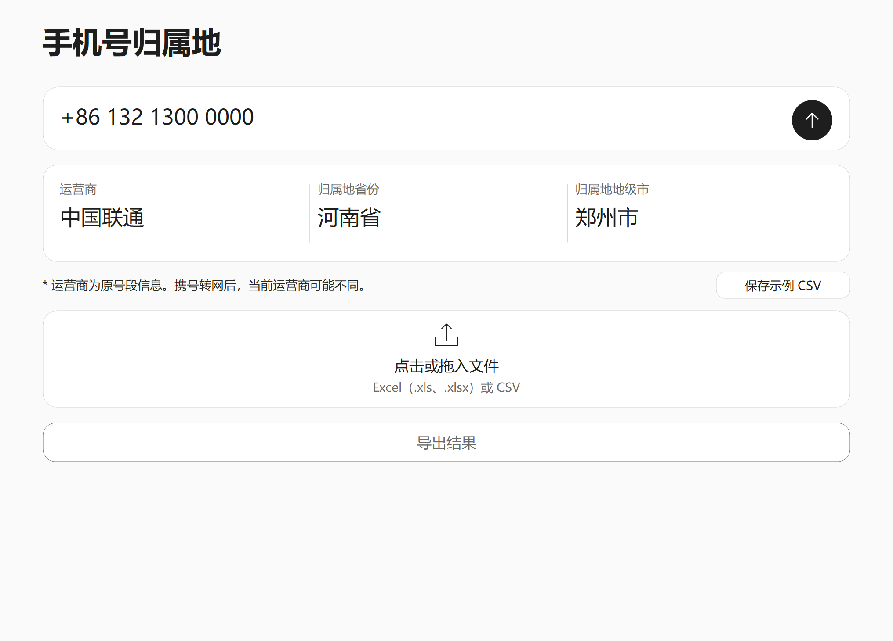
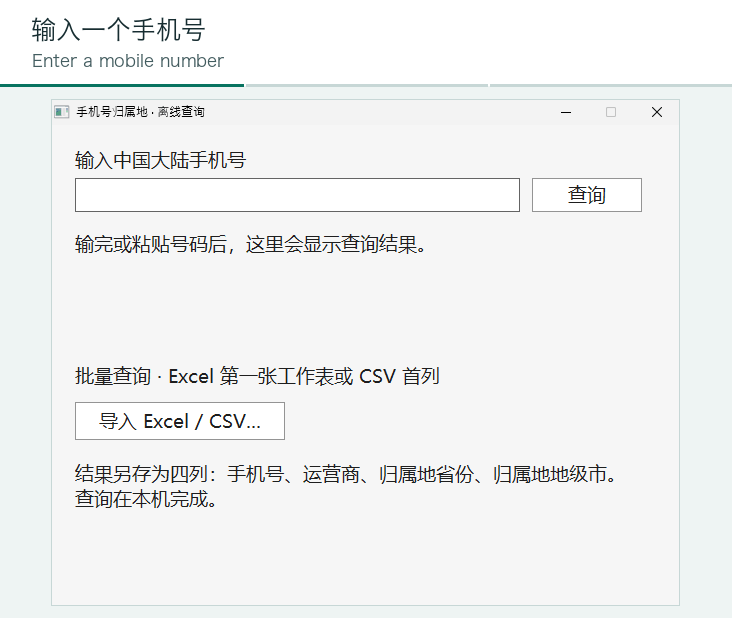

<h1 align="center">PhoneRegion</h1>

<strong>中国大陆手机号归属地查询</strong>

<strong>简体中文</strong> · <a href="README.en.md">English</a>

  
  
  
  

在断网的 Windows 电脑上，输入一个手机号即可查看<strong>原号段运营商、省份和地市</strong>。 也可以导入整张号码表，一次查询，再按需导出结果。

<h3 align="center"><a href="https://github.com/TaylorChyi/PhoneRegion/releases/latest/download/PhoneRegion.exe">⬇ 下载 Windows 版 · PhoneRegion.exe</a></h3>

下载后双击打开，无需安装、注册或配置。<a href="https://github.com/TaylorChyi/PhoneRegion/releases">查看所有版本</a>

  <picture>
    <source media="(prefers-color-scheme: dark)" srcset="docs/window-dark.png">
    
  </picture>

<a href="docs/window-light.png">浅色原图</a> · <a href="docs/window-dark.png">深色原图</a>

<h2 align="center">一个号码，马上看到结果</h2>

打开窗口即可看到运营商、省份和地市三个字段，查询前显示「—」。 粘贴 <code>+86 132 1300 0000</code> 后，直接显示<strong>中国联通 · 河南省 · 郑州市</strong>。

支持 <code>+86</code>、<code>0086</code>、<code>86</code> 国家码，也能识别全角数字、空格、括号和号码内的短横线。

<h2 align="center">整张表，也能一次查完</h2>

<a href="https://github.com/TaylorChyi/PhoneRegion/releases/download/v1.3.2/example.csv"><strong>下载示例 CSV</strong></a>，或点击拖入框上方的<strong>「保存示例 CSV」</strong>按钮，离线获取同一份示例文件。 示例含三种号码格式，单号输入框可试 <code>+86 132 1300 0000</code>。

在<strong>「点击或拖入文件」</strong>框中选择或拖入一个 Excel（<code>.xls</code>、<code>.xlsx</code>）或 CSV 文件，随后立即开始解析和查询。 号码放在首列即可，其他列无需整理，电脑也无需安装 Excel。 Excel 读取第一张工作表的 A 列，CSV 读取第一列。首行可以是「手机号」等常见表头。

同一格中用空格隔开的多个完整号码会逐个查询。 拖入框下方的<strong>「导出结果」</strong>按钮始终可见，有可导出的记录时亮起。点击后选择保存位置和 Excel／CSV 格式，取消或保存后都可以再次导出。 有效号码统一为 11 位，原顺序和重复项保留。导入时不生成结果文件，原表不变。

<table align="center">
  <thead><tr><th align="center">手机号</th><th align="center">运营商</th><th align="center">归属地省份</th><th align="center">归属地地级市</th></tr></thead>
  <tbody>
    <tr><td align="center">13213000000</td><td align="center">中国联通</td><td align="center">河南省</td><td align="center">郑州市</td></tr>
    <tr><td align="center">13900200000</td><td align="center">中国移动</td><td align="center">广东省</td><td align="center">广州市</td></tr>
    <tr><td align="center">18901600000</td><td align="center">中国电信</td><td align="center">上海市</td><td align="center">上海市</td></tr>
  </tbody>
</table>

<h2 align="center">看看实际操作</h2>

<h2 align="center">完全离线，号码留在本机</h2>

号段库已内置。查询和导出都在电脑上完成，程序不上传号码或表格，也不保存查询历史。 复制一个 <code>PhoneRegion.exe</code> 到 U 盘或另一台 Windows 10／11 x64 电脑，双击同样能用。 界面跟随 Windows 的浅色、深色或高对比度设置。

<h2 align="center">结果如何理解</h2>

内置号段库截至 <strong>2026 年 10 月 22 日</strong>，收录 <strong>522,410</strong> 个七位号段。 其中 <strong>517,515</strong> 个可确定到地市层级，其余 <strong>4,895</strong> 个只填省份，地市留空。 地市层级包括地级市、自治州、地区和盟，均显示规范名称；直辖市直接显示市名。

运营商和归属地反映号码的原始号段分配。支持中国移动、中国联通、中国电信和中国广电。 虚拟运营商品牌有收录时，会与基础运营商一起显示。 携号转网后的当前运营商可能不同，号段也无法反映持机人现在的位置。 格式错误或未收录的号码会保留在导出结果中，后三列留空。<a href="data/SOURCE.md">查看数据来源</a>

手机号归属地 · 中国大陆手机号 · 原号段运营商 · 地级市查询 · 离线查询 · Excel／CSV 批量查询

